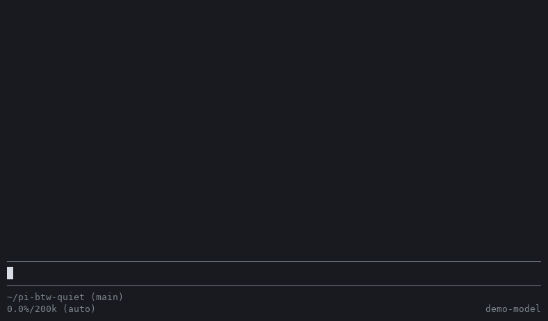
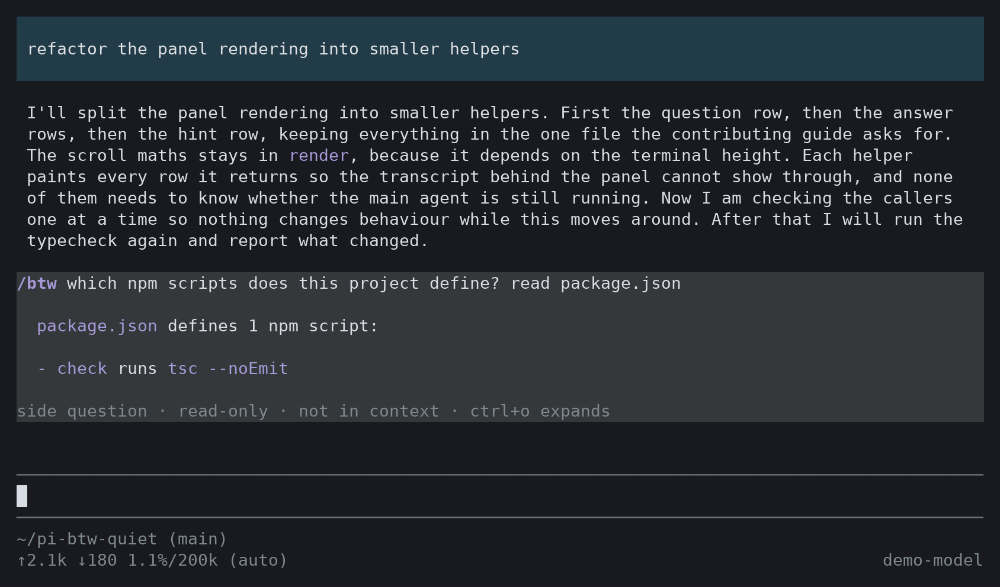
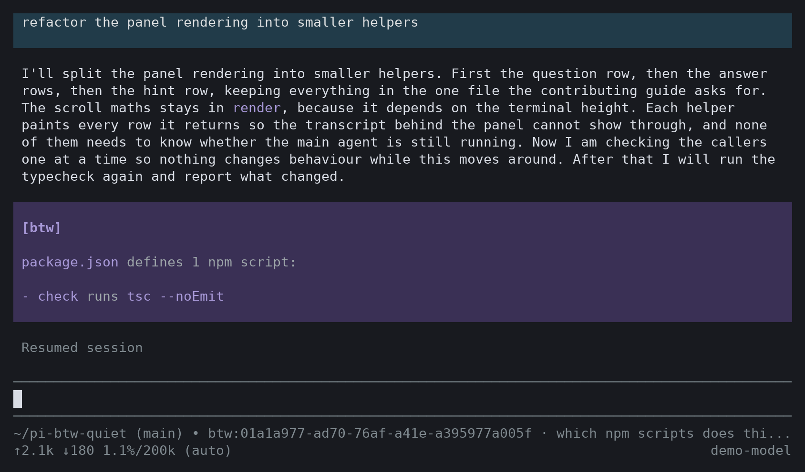

# pi-btw-quiet

[](https://github.com/Syauqi-N/pi-btw-quiet/actions/workflows/ci.yml)
[](LICENSE)

Ask a side question in [Pi](https://pi.dev) **without giving up your keyboard**.

`/btw` runs the question in its own in-memory agent session, seeded with your session transcript
and restricted to read-only tools, so it can actually look things up instead of guessing. The main
agent keeps streaming, and the panel **never takes focus**: you keep typing in the editor while the
answer arrives.



<sub>Recorded in real Pi 1.4.0 against a scripted local model. The interface and the `read` tool
call are real; the wording of the answers is canned.</sub>

## Install

```bash
pi install git:github.com/Syauqi-N/pi-btw-quiet
```

Or try it for one session:

```bash
pi -e git:github.com/Syauqi-N/pi-btw-quiet
```

The package is not on npm yet, so `npm:pi-btw-quiet` does not resolve.

Tested with Pi 1.4.0, which needs Node.js 22.19 or newer. `@earendil-works/pi-*` packages are
supplied by the host.

## Usage

### 1. Ask without stopping anything

Type `/btw <question>` at any time, including while the main agent is streaming. The panel opens
above the editor and the editor keeps the keyboard, so you can go on writing your next prompt.


Asking again while the panel is open continues the same side thread. If an answer is still
streaming, the new question waits for it to finish.

### 2. Press `tab` to use the panel's keys

The hint row under the answer always tells you which mode you are in.


Only `tab` and `esc` are handled before you opt in, and only while the editor is empty. Once the
editor has text in it, every key goes to the editor, so a prompt beginning with `f` or `x` is never
mistaken for a command.

| Key | Action |
|---|---|
| `tab` | Enter panel key mode |
| `↑` `↓` `pgup` `pgdn` | Scroll the answer |
| `shift+←` `shift+→` | Browse earlier side questions |
| `c` | Copy every answer in the panel |
| `x` | Clear the panel's history (the side agent keeps its own memory) |
| `f` | Branch the conversation from the latest answer |
| `esc` | Leave key mode, then close the panel |

### 3. Close the panel

`esc` closes the panel and stops the side agent if it is still answering. The exchange stays in your
transcript, but the next main turn never sees it.



### 4. Branch when the side question becomes the main thread

`f` creates a new session from the current position, adds the latest side answer to it, and **moves
you into it** in the same terminal. The original session is untouched.



In a branch the side answer is part of the conversation, so the model does see it. The question
that produced it is not included.

To go back, run `/btw` with no question. The branch is a normal session, so it also appears in
`/resume`, nested under the session it came from.

### Commands

| Command | What it does |
|---|---|
| `/btw <question>` | Ask a side question. |
| `/btw` | Close the panel. Inside a btw branch, return to the original session. |
| `ctrl+shift+b` / `f2` | Close the panel. |

## Configuration

By default the side agent uses the main session's model and thinking level. To pin a different
model for `/btw`, create `~/.pi/agent/btw.json`:

```json
{
	"model": "openai/gpt-5.2",
	"thinking": "low"
}
```

- `model`: `provider/modelId`, or a bare model id when it is unambiguous across providers
- `thinking`: optional, one of `off` / `minimal` / `low` / `medium` / `high` / `xhigh` / `max`
- the file is re-read before every ask, so edits apply without a restart
- an invalid config is reported and the question is dropped; it never silently falls back
- delete the file (or empty `model`) to follow the main session again

## What the side agent can do

- **Read**: `read`, `grep`, `find`, `ls`. It can inspect your repo to answer accurately.
- **Not write**: no `bash`, `edit`, or `write`. It cannot change anything.
- **See**: the main session's transcript, copied when the panel opens. Follow-ups in an open panel
  keep that copy, so close the panel and ask again to pick up newer main turns.
- **Remember**: earlier questions in the same panel, so follow-ups work.

Its session is `SessionManager.inMemory()`. Nothing it does is written to disk, and it is disposed
when the panel closes, on `/new`, `/resume`, and shutdown, so a stale transcript never leaks into a
later question.

Answers are stored as a `btw` custom entry: visible in your transcript, not sent to the model. A
side question costs context once (the transcript is read) but does not grow future turns.

If the model writes a tool call as plain text (`<function_calls>`, `<tool_use>`), the markup is
stripped and replaced with a note, rather than shown as an answer.

### Privacy

Read-only does not mean private. The tools are not limited to the project directory, so the side
agent can read any file your user can. Everything it reads, plus the session transcript, goes to the
model's provider. If you pin a model from a different provider in `btw.json`, that provider receives
your transcript too.

## Why another one

There is already [`@lanlance/pi-btw`](https://github.com/L2ncE/pi-btw), and it is good. This
project borrows its best idea (a read-only side agent that can inspect the repo) and changes the one
thing that got in the way.

| | `@lanlance/pi-btw` | `pi-btw-quiet` |
|---|---|---|
| Side agent can read the repo | ✅ `read`/`grep`/`find`/`ls` | ✅ same |
| Panel takes keyboard focus | ✅ yes (toggle with `Alt+/`) | ❌ never |
| Panel keys | active while focused | opt-in with `tab` |
| Prompt starting with `f` or `x` | can hit a panel command | reaches the editor, unless you pressed `tab` first |
| `esc` while the main agent streams | can interrupt the panel | closes only the panel |
| Pin the side agent's model | ✅ `~/.pi/agent/btw.json` | ✅ same |
| Branch the conversation | ❌ | ✅ `f` |
| Side history | 20 exchanges | 20 exchanges |
| License | Apache-2.0 | MIT |

If you like a modal overlay that grabs focus, use theirs. This one exists for people who do not
want their typing interrupted mid-run.

## Known issues

Reproduced on Pi 1.4.0 and not fixed yet. [Contributions are welcome](CONTRIBUTING.md).

- **A question asked while browsing stays hidden.** If you are browsing an earlier side question,
  the new one runs but the panel keeps showing the old one until you browse forward.
- **Dialogs do not get the keyboard first.** While the panel is open and the editor is empty, `esc`
  closes the panel rather than a dialog such as `/model`. In key mode, `c`, `x` and `f` also fire
  while you type in a dialog.
- **Tool-call stripping is imprecise.** It can damage an answer that legitimately quotes
  `<invoke>` or `<parameter>` XML, even in a code block, and it leaves parts of DeepSeek's DSML
  markup behind.

## Design notes

- **Never takes focus.** The panel is a widget above the editor and never calls `setFocus`.
- **Keys are opt-in.** `tab` arms the panel; text in the editor always wins.
- **Abort is scoped.** While the panel is open and the editor is empty, the first `esc` belongs to
  the panel and stops the side session only. After that, `esc` reaches the main agent as usual.
- **In-memory side session.** `SettingsManager.inMemory()` so the side agent's model switches never
  touch your `settings.json`.
- **Seeded through the journal.** The transcript is appended to the side session's manager before
  creation, so compaction rebuilds do not silently drop it.

## Development

Needs Node.js 22.19 or newer to run Pi.

```bash
git clone https://github.com/Syauqi-N/pi-btw-quiet
cd pi-btw-quiet
npm install
npm run check     # tsc --noEmit
pi -e ./extensions/btw.ts
```

Edit `extensions/btw.ts`, then `/reload` inside Pi. See [CONTRIBUTING.md](CONTRIBUTING.md) for the
behaviours to verify by hand.

## Releasing

The version lives in `package.json` and `CHANGELOG.md`. Publishing is driven by a tag:

```bash
npm version patch --no-git-tag-version   # or minor / major
git commit -am "chore: release v0.3.1"
git tag v0.3.1
git push origin main --tags
```

`.github/workflows/publish.yml` then typechecks, verifies the tag matches `package.json`, and
publishes to npm. It needs an npm automation token in the `NPM_TOKEN` repository secret.

## Credits

The read-only side-agent approach, seeding an in-memory `AgentSession` with the main transcript and
whitelisting `read`/`grep`/`find`/`ls`, follows
[`L2ncE/pi-btw`](https://github.com/L2ncE/pi-btw) (Apache-2.0). This implementation is written
independently and differs in the parts listed above.

## License

[MIT](LICENSE)
