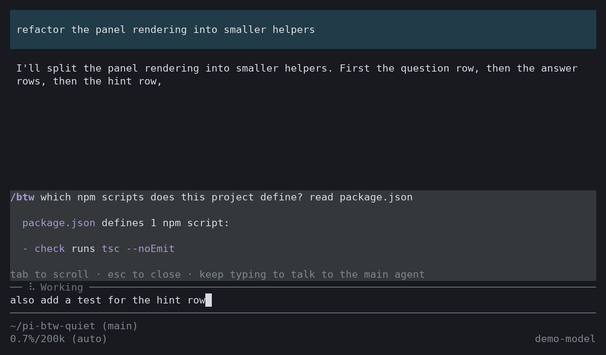
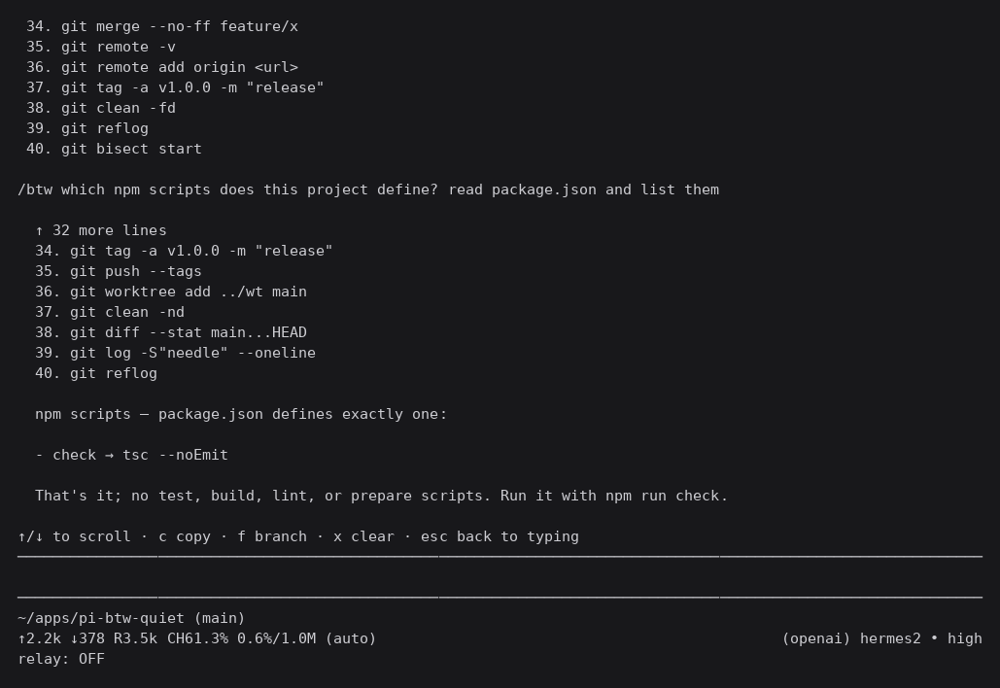

# pi-btw-quiet

Ask a side question in [Pi](https://pi.dev) **without giving up your keyboard**.

`/btw` runs the question in its own in-memory agent session, seeded with your session transcript
and restricted to read-only tools — so it can actually look things up instead of guessing. The main
agent keeps streaming, and the panel **never takes focus**: you keep typing in the editor while the
answer arrives.



Press `tab` to use the panel's keys. The hint row always tells you which mode you are in:



## Why another one

There is already [`@lanlance/pi-btw`](https://github.com/L2ncE/pi-btw), and it is good — this
project borrows its best idea (a read-only side agent that can inspect the repo) and changes the one
thing that got in the way.

| | `@lanlance/pi-btw` | `pi-btw-quiet` |
|---|---|---|
| Side agent can read the repo | ✅ `read`/`grep`/`find`/`ls` | ✅ same |
| Panel takes keyboard focus | ✅ yes (toggle with `Alt+/`) | ❌ never |
| Panel keys | active while focused | opt-in with `tab` |
| Prompt starting with `f` or `x` | can hit a panel command | always reaches the editor |
| `esc` while the main agent streams | can interrupt the panel | closes only the panel |
| Branch the conversation | ❌ | ✅ `f` |
| Side history | 20 exchanges | 10 exchanges |
| License | Apache-2.0 | MIT |

If you like a modal overlay that grabs focus, use theirs — it is more mature and has a larger
history buffer. This one exists for people who do not want their typing interrupted mid-run.

## Install

```bash
pi install npm:pi-btw-quiet
```

Or from git:

```bash
pi install git:github.com/Syauqi-N/pi-btw-quiet
```

Or try it for one session:

```bash
pi -e npm:pi-btw-quiet
```

Requires Pi with extension support. `@earendil-works/pi-*` packages are supplied by the host.

## Usage

| Command | What it does |
|---|---|
| `/btw <question>` | Ask a side question. Works while the main agent is streaming. |
| `/btw` | Close the panel. Inside a btw branch, jump back to the original session. |
| `ctrl+shift+b` / `f2` | Close the panel. |

Follow-up `/btw` questions while a panel is open continue the same side thread.

### Panel keys

Keys are **opt-in**. Nothing is intercepted until you press `tab`, and even then only while the
editor is empty.

| Key | Action |
|---|---|
| `tab` | Enter panel key mode |
| `↑` `↓` `pgup` `pgdn` | Scroll the answer |
| `shift+←` `shift+→` | Browse earlier side questions |
| `c` | Copy the answer |
| `x` | Clear the panel's side-question history |
| `f` | Branch the conversation here |
| `esc` | Leave key mode, then close the panel |

If you start typing a normal prompt, every key goes to the editor — so a prompt beginning with `f`
or `x` is never mistaken for a command.

### Branching

`f` creates a new session from the current position, seeds it with the side question and answer, and
**moves you into it** in the same terminal. The original session is untouched.

Inside a branch, `/btw` with no question returns you to the session you branched from. The branch is
a normal session, so it also appears in `/resume`.

## What the side agent can do

- **Read**: `read`, `grep`, `find`, `ls`. It can inspect your repo to answer accurately.
- **Not write**: no `bash`, `edit`, or `write`. It cannot change anything.
- **See**: the main session's transcript, seeded into its own in-memory session.
- **Remember**: earlier questions in the same panel, so follow-ups work.

Its session is `SessionManager.inMemory()` — nothing is written to disk, and it is disposed on
`/new`, `/resume`, and shutdown so a stale transcript never leaks into a later question.

Answers are stored as a `btw` custom entry: visible in your transcript, **never sent to the model**.
So a side question costs context once (the transcript is read) but never pollutes future turns.

If the model writes a tool call as plain text (DeepSeek's `<｜｜DSML｜｜>`, `<function_calls>`,
`<tool_use>`), the markup is stripped and replaced with a note, rather than shown as an answer.

## Design notes

- **Never takes focus.** The panel is a widget above the editor and never calls `setFocus`.
- **Keys are opt-in.** `tab` arms the panel; typing disarms the idea entirely.
- **Abort is scoped.** `esc` stops the side session only. The main agent's `esc` is untouched.
- **In-memory side session.** `SettingsManager.inMemory()` so the side agent's model switches never
  touch your `settings.json`.
- **Seeded through the journal.** The transcript is appended to the side session's manager before
  creation, so compaction rebuilds do not silently drop it.

## Development

```bash
git clone https://github.com/Syauqi-N/pi-btw-quiet
cd pi-btw-quiet
npm install
npm run check     # tsc --noEmit
pi -e ./extensions/btw.ts
```

Edit `extensions/btw.ts`, then `/reload` inside Pi.

## Credits

The read-only side-agent approach — seeding an in-memory `AgentSession` with the main transcript and
whitelisting `read`/`grep`/`find`/`ls` — follows
[`L2ncE/pi-btw`](https://github.com/L2ncE/pi-btw) (Apache-2.0). This implementation is written
independently and differs in the parts listed above.

## License

MIT
